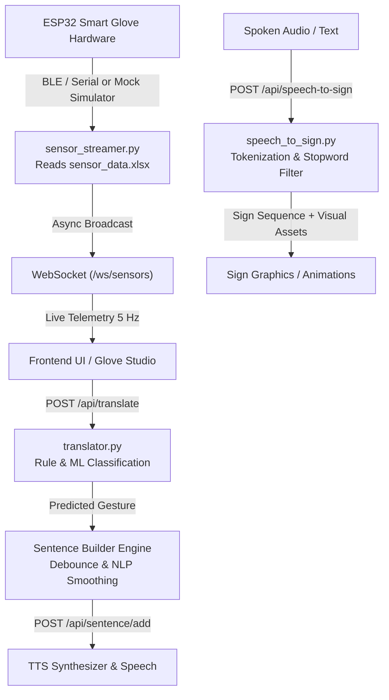

# 🧤 Sign-to-Speech Smart Glove IoT Backend

High-performance, asynchronous Python backend powered by **FastAPI** for translating Smart Glove sensor telemetry (flex sensors + MPU6050 6-DOF IMU) into spoken speech, textual subtitles, and bidirectional Sign-to-Speech / Speech-to-Sign animations.

---

## 🏛️ System Architecture



---

## 📂 Project Directory Structure

```text
Myproject/
├── .venv/                         # Python 3.11 virtual environment
├── requirements.txt               # Dependencies (FastAPI, uvicorn, websockets, openpyxl, etc.)
├── main.py                        # FastAPI application entrypoint with CORS & routing
├── config.py                      # System configuration & file paths
├── data/
│   ├── sensor_data.xlsx           # 340-row mock telemetry dataset (Excel)
│   ├── sensor_data.csv            # CSV fallback dataset
│   └── create_mock_data.py        # Dataset generation script
├── models/
│   ├── __init__.py
│   └── schemas.py                 # Pydantic request/response schemas
├── services/
│   ├── __init__.py
│   ├── sensor_streamer.py         # 200ms background Excel streamer & WebSocket broadcaster
│   ├── translator.py              # Sensor classifier & grammatical sentence builder
│   ├── speech_to_sign.py          # Interlocutor speech-to-sign mapper
│   └── tts_service.py             # Speech synthesis metadata & audio generator
├── routers/
│   ├── __init__.py
│   ├── sensors.py                 # GET /api/sensors/latest & WS /ws/sensors
│   ├── translation.py             # POST /api/translate & GET /api/gestures
│   ├── sentence.py                # POST /api/sentence/add, DELETE /api/sentence/clear
│   ├── speech_to_sign.py          # POST /api/speech-to-sign & GET /api/speech-to-sign/vocab
│   └── simulator.py               # POST /api/simulator/control (pause, play, speed)
├── static/
│   ├── index.html                 # Interactive live testing studio & dashboard
│   ├── style.css                  # Dark-mode glassmorphic styling
│   ├── app.js                     # WebSocket telemetry client & Web Speech TTS
│   ├── generate_assets.py         # SVG vector icon generator
│   └── assets/
│       └── signs/                 # Crisp vector illustrations for sign tokens
└── tests/
    └── test_backend.py            # Comprehensive Pytest test suite (100% passing)
```

---

## 🚀 Setup & Execution Guide

### 1. Prerequisites
- Python 3.10+ installed (Python 3.11 recommended).

### 2. Environment Setup
```powershell
# Create virtual environment
python -m venv .venv

# Activate virtual environment
# Windows (PowerShell):
.\.venv\Scripts\Activate.ps1
# Linux / macOS:
source .venv/bin/activate

# Install dependencies
pip install -r requirements.txt
```

### 3. Generate Mock Telemetry (Optional - Already Created)
```powershell
python data/create_mock_data.py
```

### 4. Run the Backend Server
```powershell
uvicorn main:app --reload --host 127.0.0.1 --port 8000
```

Once running:
- **Interactive Glove Studio UI:** [http://127.0.0.1:8000](http://127.0.0.1:8000)
- **Interactive Swagger API Docs:** [http://127.0.0.1:8000/docs](http://127.0.0.1:8000/docs)
- **Alternative ReDoc UI:** [http://127.0.0.1:8000/redoc](http://127.0.0.1:8000/redoc)

---

## 🔌 API Specification & Examples

### 1. `GET /api/sensors/latest`
Fetches the latest reading row from the mock Excel telemetry dataset.

**Response (200 OK):**
```json
{
  "timestamp": 18.8,
  "thumb_flex": 656.0,
  "index_flex": 828.0,
  "middle_flex": 279.0,
  "ring_flex": 288.0,
  "pinky_flex": 298.0,
  "accel_x": 0.38,
  "accel_y": -2.05,
  "accel_z": 8.79,
  "gyro_x": 34.8,
  "gyro_y": -11.9,
  "gyro_z": 4.9,
  "gesture_id": 105,
  "ground_truth_label": "Need"
}
```

---

### 2. `WS /ws/sensors`
Live WebSocket channel pushing glove telemetry every 200ms (5 Hz).

**Broadcast Message Payload:**
```json
{
  "type": "telemetry",
  "index": 42,
  "total_rows": 340,
  "sensors": {
    "thumb_flex": 450,
    "index_flex": 510,
    "middle_flex": 100,
    "ring_flex": 90,
    "pinky_flex": 80,
    "accel_x": 0.1,
    "accel_y": 0.9,
    "accel_z": 9.8,
    "gyro_x": 5.0,
    "gyro_y": 12.0,
    "gyro_z": 3.0
  },
  "classification": {
    "gesture_label": "Help",
    "confidence": 0.98,
    "gesture_id": 102,
    "description": "Emergency call for assistance",
    "tts_speech_hint": "Help me, please."
  },
  "current_sentence": "I need help immediately.",
  "active_buffer": ["I", "Need", "Help"]
}
```

---

### 3. `POST /api/translate`
Classifies raw sensor values through the model engine.

**Request:**
```bash
curl -X POST http://127.0.0.1:8000/api/translate \
  -H "Content-Type: application/json" \
  -d '{
    "thumb": 450,
    "index": 510,
    "middle": 100,
    "ring": 90,
    "pinky": 80,
    "ax": 0.1,
    "ay": 0.9,
    "az": 9.8
  }'
```

**Response (200 OK):**
```json
{
  "gesture_label": "Help",
  "confidence": 0.98,
  "gesture_id": 102,
  "description": "Emergency call for assistance",
  "tts_speech_hint": "Help me, please."
}
```

---

### 4. `POST /api/sentence/add`
Appends a recognized sign into the active sentence buffer with debounce protection and NLP grammar smoothing.

**Request:**
```bash
curl -X POST http://127.0.0.1:8000/api/sentence/add \
  -H "Content-Type: application/json" \
  -d '{"word": "Hospital"}'
```

**Response (200 OK):**
```json
{
  "current_sentence": "I need to go to the hospital.",
  "buffer": ["I", "Need", "Hospital"],
  "status": "success",
  "tts_metadata": {
    "text": "I need to go to the hospital.",
    "lang": "en-US",
    "rate": 1.0,
    "pitch": 1.0,
    "volume": 1.0,
    "trigger_auto_play": true
  }
}
```

---

### 5. `DELETE /api/sentence/clear`
Clears the active sentence buffer and resets word queue.

**Request:**
```bash
curl -X DELETE http://127.0.0.1:8000/api/sentence/clear
```

**Response (200 OK):**
```json
{
  "current_sentence": "",
  "buffer": [],
  "word_count": 0,
  "status": "cleared"
}
```

---

### 6. `POST /api/speech-to-sign`
Converts input speech from a conversational partner into corresponding sign language visual animation/token sequences.

**Request:**
```bash
curl -X POST http://127.0.0.1:8000/api/speech-to-sign \
  -H "Content-Type: application/json" \
  -d '{"text": "Where is the exit?"}'
```

**Response (200 OK):**
```json
{
  "sign_sequence": ["WHERE", "EXIT"],
  "image_urls": ["/assets/signs/where.svg", "/assets/signs/exit.svg"],
  "original_text": "Where is the exit?",
  "details": [
    { "word": "where", "token": "WHERE", "asset_url": "/assets/signs/where.svg", "matched": true, "category": "question" },
    { "word": "is", "token": null, "asset_url": null, "matched": false, "omitted_as_stopword": true },
    { "word": "the", "token": null, "asset_url": null, "matched": false, "omitted_as_stopword": true },
    { "word": "exit", "token": "EXIT", "asset_url": "/assets/signs/exit.svg", "matched": true, "category": "direction" }
  ]
}
```

---

### 7. `POST /api/simulator/control`
Allows dynamic control over the mock dataset telemetry playback.

**Actions:**
- `{"action": "pause"}`
- `{"action": "play"}`
- `{"action": "restart"}`
- `{"action": "speed", "speed_factor": 2.0}`

---

## 🧪 Running Automated Tests

Run the full pytest suite:
```powershell
.\.venv\Scripts\pytest.exe tests\test_backend.py -v
```

All 7 automated tests validate:
- ✅ Health check & simulator status
- ✅ Latest sensor retrieval (`GET /api/sensors/latest`)
- ✅ Sensor array gesture translation (`POST /api/translate`)
- ✅ Full Sentence Builder pipeline (`POST /api/sentence/add` & `DELETE /api/sentence/clear`)
- ✅ Bidirectional Speech-to-Sign tokenization (`POST /api/speech-to-sign`)
- ✅ Telemetry playback controls (`POST /api/simulator/control`)
- ✅ Live WebSocket streaming (`WS /ws/sensors`)
